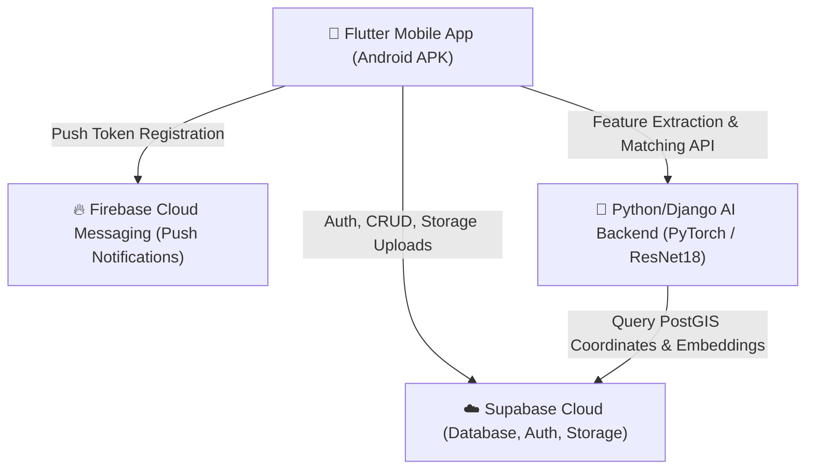

# Paws and Found — End-to-End Deployment & APK Build Guide

This guide outlines the complete process to deploy the online backend services (Supabase, Firebase, and the Python AI Matching Engine) and compile the production Android APK for **Paws and Found**.

---

## 1. System Architecture



---

## 2. Prerequisites

| Tool | Recommended Version | Purpose |
| :--- | :--- | :--- |
| **Flutter SDK** | `3.24.x` or higher | Mobile app compilation |
| **Android SDK / JDK** | JDK 17, Android SDK 34 | Android packaging |
| **Python** | `3.10` – `3.11` | AI Backend runtime |
| **Docker** | Latest *(Optional)* | Containerized AI deployment |
| **Supabase CLI** | Latest *(Optional)* | Database migrations |

---

## 3. Step-by-Step Deployment

### Phase 1: Database & Supabase Cloud Setup

The mobile app is pre-configured to communicate with the project's cloud Supabase instance:
- **Supabase URL:** `https://pbbrnlytulbaylsbpagx.supabase.co`
- **Config Location:** `mobile_app/lib/core/constants/api_constants.dart`

#### 1. Apply Migrations
Ensure all SQL migration scripts located in `supabase/migrations/` are applied to the remote database:
```bash
# Using Supabase CLI:
supabase link --project-ref pbbrnlytulbaylsbpagx
supabase db push
```
*(Alternatively, execute the `.sql` scripts in order using the Supabase Dashboard SQL Editor).*

#### 2. Confirm Storage Buckets
Ensure the following buckets exist under **Storage** and have public read policies enabled:
- `animal-photos` — User uploads of lost, found, and sighted animals.
- `user_profile_photo` — Profile avatars.
- `recover-proof` — Pet recovery verification images.

#### 3. Google Sign-In Provider
In **Supabase Dashboard $\rightarrow$ Authentication $\rightarrow$ Providers $\rightarrow$ Google**:
- Ensure the Google provider is enabled.
- Verify the Web Client ID matches:
  `467320972940-idmruqnpvd1fvuv1h7l24oqpvjcn56qb.apps.googleusercontent.com`

---

### Phase 2: Deploying the Python/Django AI Backend

The AI service (`backend/`) extracts deep visual embeddings (`ResNet18` + `SSDLite` crop) to match missing pets with sighting reports. Because a physical mobile phone cannot access `localhost`, the backend must be publicly accessible over HTTPS.

#### Option A: Cloud Deployment (Render, Railway, Fly.io, or VPS) — *Recommended*
The backend repository contains a pre-configured `backend/Dockerfile`.

1. **Deploy Container:**
   Link the `backend/` folder to your cloud host (e.g., Render Web Service or Railway).
2. **Environment Variables:**
   Set the following variables in your hosting environment (refer to `backend/.env.example`):
   ```env
   DEBUG=False
   SECRET_KEY=generate-a-strong-random-key-here
   ALLOWED_HOSTS=*
   
   # Database connection (Supabase Session Pooler)
   DB_HOST=aws-0-ap-south-1.pooler.supabase.com
   DB_PORT=5432
   DB_NAME=postgres
   DB_USER=django_backend.pbbrnlytulbaylsbpagx
   DB_PASSWORD=<SUPABASE_DB_PASSWORD>
   DB_SSLMODE=require

   # Supabase API
   SUPABASE_URL=https://pbbrnlytulbaylsbpagx.supabase.co
   SUPABASE_SERVICE_ROLE_KEY=<SUPABASE_SERVICE_ROLE_KEY>
   SUPABASE_STORAGE_BUCKET=animal-photos

   # AI Inference Settings
   EMBEDDING_MODEL_VERSION=resnet18-in1k-v1+ssdlite-crop-v1
   TORCH_THREADS=4
   MATCH_BASE_SIMILARITY=0.78
   ```
3. **Verify Deployment:**
   Visit `https://<YOUR_DEPLOYED_URL>/api/health/`. It should return:
   ```json
   {"status": "healthy"}
   ```

#### Option B: Quick Demo / Testing via Tunnel (Ngrok / Cloudflare Tunnel)
To test immediately using a locally running backend:
1. Start the Django server locally:
   ```powershell
   cd backend
   python -m venv venv
   .\venv\Scripts\activate
   pip install -r requirements.txt
   python manage.py runserver 0.0.0.0:8000
   ```
2. In a separate terminal, expose port 8000:
   ```powershell
   ngrok http 8000
   ```
   *(Note the generated HTTPS URL, e.g., `https://abc123.ngrok-free.app`)*

---

### Phase 3: Firebase Cloud Messaging (FCM) & Google SHA-1

1. The configuration file `mobile_app/android/app/google-services.json` is already present.
2. In the **Firebase Console** $\rightarrow$ **Project Settings**:
   - Add the SHA-1 and SHA-256 fingerprints of the keystore used to sign the APK.
   - For debug builds:
     ```powershell
     keytool -list -v -keystore ~/.android/debug.keystore -alias androiddebugkey -storepass android -keypass android
     ```
   - For release builds: extract the fingerprint from your production `.jks` file.

---

### Phase 4: Compiling the Android APK

When compiling the Flutter app, pass the public AI backend URL via `--dart-define=DJANGO_BASE_URL`:

#### 1. Run Pre-Build Verification
```powershell
cd mobile_app
flutter analyze
flutter test
```

#### 2. Build Release APK
```powershell
flutter build apk --release --dart-define=DJANGO_BASE_URL="https://<YOUR_BACKEND_URL>"
```
*(Replace `https://<YOUR_BACKEND_URL>` with your deployed Render/Railway domain or your active ngrok URL without a trailing slash).*

#### 3. Build Output
The production APK will be generated at:
```text
mobile_app/build/app/outputs/flutter-apk/app-release.apk
```

---

## 4. Post-Deployment Verification Checklist

Once the APK is installed on a physical device:
- [ ] **Authentication:** Test Sign-In with Email/Password and Google Sign-In.
- [ ] **Camera & AI Pre-Match:** Snap an animal photo in `/camera`. Confirm feature extraction runs and returns match candidates.
- [ ] **Animal Map:** Report a sighting and verify the pin appears live on OpenStreetMap.
- [ ] **Community Moderation:** Try posting a comment with a restricted word (e.g., *"buang"*); confirm the `CommunityWarningDialog` displays and blocks submission.
- [ ] **Account Restriction Guard:** Ensure accounts reaching suspension cannot access `/feed` and are presented with the **"Contact Admin"** appeal screen.
- [ ] **Push Notifications:** Test that missing pet alerts trigger sound chimes and heads-up notifications.
