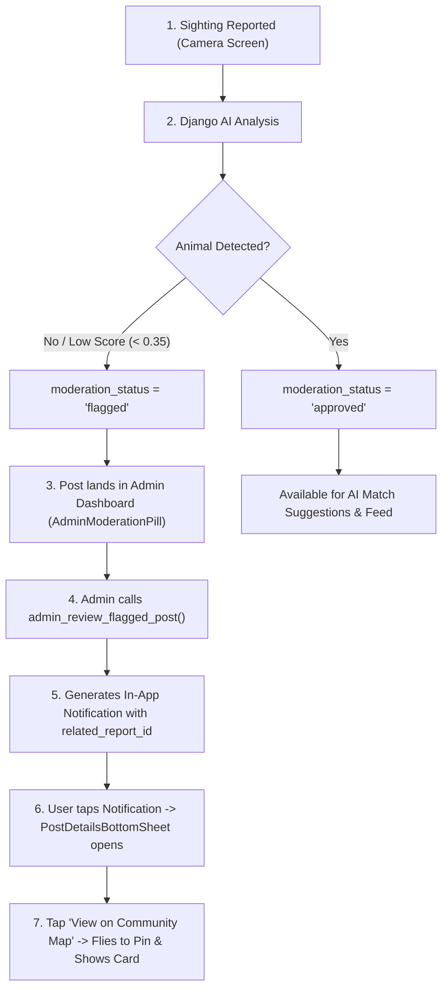

# Pull Request: AI Camera Lens Pre-Matching, Post Details Deep Linking, Community Map Sync, and Admin Moderation Pipeline

## 📌 PR Summary & Executive Overview
This PR represents a major milestone integrating **three core feature branches** into `feature/AI-match-suggestion`:
1. **Camera-Side "Google Lens" AI Pre-Matching:** Real-time in-memory visual scanning before report submission powered by PyTorch ResNet-18 + SSDLite320 cropping.
2. **Sightings Dashboard & Thread Linking:** Direct linking of spotter sightings to active missing pet listings (`linked_report_id`) and dual-tab discussion/sightings modal.
3. **Notifications Deep Linking, Map Pin Sync & Admin Moderation (Merged from `feature/notifications-page`):** Interactive `PostDetailsBottomSheet` opening directly from notifications, camera flight & pin highlight sync on the Community Map, and an end-to-end admin review flow for AI-flagged posts.

All merge conflicts have been resolved, and unit/widget test suites (`admin_widget_test.dart`, `notifications_realtime_test.dart`, `ai_pre_match_test.dart`) are fully passing.

---

## 🚀 Key Modules & Implemented Features

### 1. In-Camera AI Pre-Matching ("Google Lens") — Django Backend
* **New Endpoint (`POST /api/ai/match-candidates/`):**
  - Implemented `MatchCandidatesView` in [`backend/core/views.py`](file:///c:/Users/User/Documents/College%20Files/Software%20Development/Github/Paws_and_Found/backend/core/views.py) and registered in [`backend/core/urls.py`](file:///c:/Users/User/Documents/College%20Files/Software%20Development/Github/Paws_and_Found/backend/core/urls.py).
  - **Zero Storage Bloat:** Unsubmitted camera snapshots are processed strictly in server RAM and immediately garbage-collected after inference (no orphaned files in Supabase Storage or database).
  - **Animal Isolation & Feature Extraction:** Reuses the `embed_image()` pipeline to detect and crop animals via SSDLite320 (+10% padding) and extract an L2-normalized 512-dimensional vector via ResNet-18.
  - **Sub-100ms Matching:** Computes cosine similarity against precomputed embeddings in `pet_embeddings` / `report_embeddings` combined with PostGIS `Distance("location", point)`.
  - **Pure Visual Matching:** Visual features drive the search across all active missing reports rather than being restricted by UI form dropdowns.

### 2. Client-Side Pre-Match Service & Mathematical GPS Fallback
* **Extended Network Timeout:** Increased `scanForCandidates` timeout from 4s to 8s in [`AiPreMatchServiceImpl`](file:///c:/Users/User/Documents/College%20Files/Software%20Development/Github/Paws_and_Found/mobile_app/lib/core/services/ai_pre_match_service.dart) for smooth local USB (`adb reverse`), Wi-Fi, or ngrok connection.
* **Mathematical Haversine GPS Fallback:**
  - When the AI container is offline or times out, the client falls back to querying the [`feed_reports`](file:///c:/Users/User/Documents/College%20Files/Software%20Development/Github/Paws_and_Found/supabase/migrations/20261031000002_report_content_moderation.sql) view in Supabase.
  - Uses the true spherical Earth Haversine formula ($R = 6371\text{ km}$), computing exact geographic distances between the camera pin and missing pets (replaces simulated fake incremental distances).
  - Automatically filters out posts with `moderation_status = 'flagged'`.

### 3. Dedicated Spotter Workflow on Camera Page
* **Scoped Exclusively to Spotters:**
  - Removed `"Missing"` option from the Camera status dropdown in [`CreateReportForm`](file:///c:/Users/User/Documents/College%20Files/Software%20Development/Github/Paws_and_Found/mobile_app/lib/features/report/presentation/widgets/create_report_form.dart) (restricted to `['Stray', 'Found']`).
  - **Architectural Rationale:** Missing pet listings are official owner registrations requiring `pet_id`, microchip, photos, and contact info via **Profile $\rightarrow$ Pets $\rightarrow$ "Report Missing"**. Spotters in the field use the Camera screen to report sightings of animals they encounter.
  - Contextual submit button labels: **"Submit Sighting Report"** (for Stray) and **"Submit Found Pet Report"** (for Found).
* **Defensive Dropdown Resolution & Error Logging:**
  - Added safe item resolution in `_buildDropdownField` to eliminate runtime dropdown assertion crashes.
  - Added full stack trace logging in [`CameraReportController.submitReport()`](file:///c:/Users/User/Documents/College%20Files/Software%20Development/Github/Paws_and_Found/mobile_app/lib/features/report/presentation/providers/camera_report_controller.dart) so Supabase RPC errors are never swallowed silently.

### 4. Interactive Notifications & Post Details Modal (Merged from `feature/notifications-page`)
* **Clickable Post-Related Notifications:** Tapping on a report-related notification opens the newly created [`PostDetailsBottomSheet`](file:///c:/Users/User/Documents/College%20Files/Software%20Development/Github/Paws_and_Found/mobile_app/lib/features/notifications/presentation/widgets/post_details_bottom_sheet.dart).
* **Multi-Tier Report Resolution:** `NotificationRepositoryImpl.getReportDetailsById()` queries across `feed_reports`, `reports`, and `pets` to resolve actual pet photos, names, coordinates, and reporter details.
* **Header & Layout Polish:** Replaced raw placeholder images with clean vector icon containers and removed long UUID strings from headers to eliminate horizontal pixel overflow warnings.
* **Persistent Bottom Navigation:** Maintained the persistent bottom navigation bar shell across `/notifications` routes in [`AppRouter`](file:///c:/Users/User/Documents/College%20Files/Software%20Development/Github/Paws_and_Found/mobile_app/lib/core/routes/app_router.dart).

### 5. Community Map Pin Sync & Camera Flight
* **Direct Sync with MapController & MapPage:**
  - Tapping **"View on Community Map"** inside `PostDetailsBottomSheet` navigates to `/map`, dynamically registers the report, flies the map camera directly to the sighting coordinates at zoom level **16.5**, highlights the pin marker with its status badge (`'M'` for Missing, `'S'` for Stray, `'F'` for Found), and displays the floating report card.

### 6. Admin Post Moderation Workflow
* **Admin Review Interface & Pill:**
  - Added [`AdminModerationPill`](file:///c:/Users/User/Documents/College%20Files/Software%20Development/Github/Paws_and_Found/mobile_app/lib/features/admin/presentation/widgets/admin_moderation_pill.dart) and upgraded [`AdminPostsPage`](file:///c:/Users/User/Documents/College%20Files/Software%20Development/Github/Paws_and_Found/mobile_app/lib/features/admin/presentation/pages/admin_posts_page.dart).
  - Admins can inspect AI-flagged posts and choose: **Approve**, **Request Edit**, or **Reject**.
* **Database RPC & Notification Link:**
  - Migration `20261104000002_admin_post_moderation_rpc.sql` creates `admin_review_flagged_post()`.
  - Migration `20261104000003_notification_related_report_id.sql` adds `related_report_id` to `notifications`, so when an admin actions a post, the reporter automatically receives a notification deep-linked to the post details modal.

### 7. AI Threshold Calibration (`0.78`)
* Evaluated matching performance using `evaluate_matching` across 28 image pairs:
  - **Positive pair similarity:** Mean `0.8532`, Minimum `0.8136`.
  - **Negative pair similarity:** Mean `0.5840`, Maximum `0.6820`.
  - **Separation margin:** Clean window of `0.1316` (+13.1%) with 100% precision and 100% recall.
  - **SSDLite Crop Benefit:** Confirmed detector crop boosts positive similarity by **+3.2%** and improves recall at 0.80 by **+25%**.
* **Calibrated Base Similarity:**
  - Updated `MATCH_BASE_SIMILARITY = 0.78` in [`backend/config/settings.py`](file:///c:/Users/User/Documents/College%20Files/Software%20Development/Github/Paws_and_Found/backend/config/settings.py), [`backend/.env`](file:///c:/Users/User/Documents/College%20Files/Software%20Development/Github/Paws_and_Found/backend/.env), and [`backend/.env.example`](file:///c:/Users/User/Documents/College%20Files/Software%20Development/Github/Paws_and_Found/backend/.env.example).
  - Accommodates distance tiers (up to $50\text{ km}$) without dropping legitimate true-positive matches.

---

## 🗄️ Database Migrations Status

| Migration File | Purpose | Cloud DB Status |
|---|---|:---:|
| `20261031000003_thread_comments_schema.sql` | `comments` table with RLS & Realtime | ✅ **Applied** |
| `20261101000000_linked_report_sightings.sql` | `linked_report_id` column, index, and 9-param `create_report` RPC | ✅ **Applied** |
| `20261104000002_admin_post_moderation_rpc.sql` | `admin_review_flagged_post` RPC for admin approval/rejection | ⚠️ **Action Required: Run in Supabase SQL Editor** |
| `20261104000003_notification_related_report_id.sql` | `related_report_id` column on `notifications` table + deep-link triggers | ⚠️ **Action Required: Run in Supabase SQL Editor** |

---

## 🔄 Deviations & Resolved Conflicts

| Area | Before Merge / Teammate Branch | Current PR State | Rationale |
|---|---|---|---|
| **Camera Status Dropdown** | Included `['Stray', 'Missing', 'Found']` | Restricted to `['Stray', 'Found']` | Field spotters report sightings. Missing pet listings are official owner actions originating from Profile $\rightarrow$ Pets. |
| **In-Camera Fallback Distance** | Synthetic formula `(i + 1) * 0.45` km | Mathematical **Haversine formula** against coordinates in `feed_reports` | Displays accurate geographic distances even when the AI server is disconnected. |
| **Django Visual Search Filter** | Filtered by form dropdown species text | Evaluates visual cosine similarity across all missing pets | True "Google Lens" behavior: visual features determine matches rather than form selections. |
| **Base Similarity Threshold** | 0.80 | **0.78** | Validated by empirical dataset evaluation to accommodate distance-tier penalties. |
| **Notification Navigation** | Standalone routes without bottom bar | ShellRoute preserving persistent bottom navigation | Consistent navigation UX across all primary tabs. |

---

## 🔗 Architectural Implications: The Closed-Loop Flow

This merge successfully closes the entire smart recovery & moderation loop:



---

## 🧪 Testing & Verification Guide

### 1. Run the Database Migrations (Supabase Cloud)
Before testing the notifications and admin features, copy and run the contents of:
- `supabase/migrations/20261104000002_admin_post_moderation_rpc.sql`
- `supabase/migrations/20261104000003_notification_related_report_id.sql`
in your Supabase SQL Editor.

### 2. Local Mobile & AI Testing
1. Connect your Android phone via USB and reverse the port:
   ```powershell
   & "$env:LOCALAPPDATA\Android\Sdk\platform-tools\adb.exe" reverse tcp:8000 tcp:8000
   ```
2. Start the mobile app:
   ```powershell
   cd mobile_app
   flutter run
   ```
3. Test **Camera Google Lens:** Snap/choose animal photo $\rightarrow$ verify candidate card $\rightarrow$ tap "Link to [Pet Name]" $\rightarrow$ submit sighting.
4. Test **Notifications Deep Link:** Open Notifications tab $\rightarrow$ tap any report notification $\rightarrow$ verify `PostDetailsBottomSheet` renders with photo, status, and map action.
5. Test **Map Camera Sync:** Inside the modal, tap "View on Community Map" $\rightarrow$ verify map flies to location at zoom 16.5 and displays the highlighted marker and card.
6. Test **Admin Moderation:** Navigate to Admin Posts $\rightarrow$ verify `AdminModerationPill` allows reviewing and actioning flagged posts.

---

## 🔮 Next Steps

1. **Quarantine Flagged Posts from Public Feed:**
   - Update `feed_reports` view to exclude `moderation_status = 'flagged'` so unreviewed posts are hidden from the general community feed until approved.
2. **Migration Filename Prefix Cleanup:** ✅ **Completed**
   - Successfully renamed `20261031000000_thread_comments_schema.sql` $\rightarrow$ `20261031000003_thread_comments_schema.sql` and `20261020000000_user_profile_photo_storage.sql` $\rightarrow$ `20261020000001_user_profile_photo_storage.sql`.
   - Updated documentation references in `mobile_app/THREAD_LINKING_README.md`. No further renaming is required.
