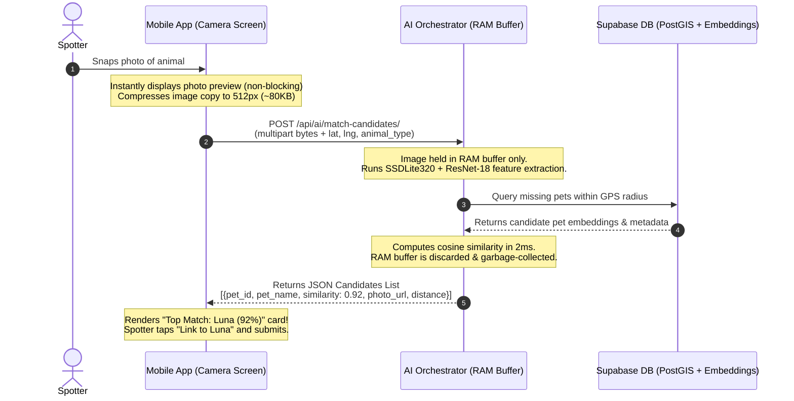

# Feature Proposal & Architecture Plan: Real-Time AI Camera Lens & Sightings Dashboard

**Document Version:** 2.0 (Updated with In-Camera AI Pre-Matching & Solution to Unsubmitted Image Processing)  
**Target Project:** Paws and Found Mobile App & Backend AI Orchestrator  
**Status:** Proposal for Team & Leader Review  

---

## 1. Executive Summary

This proposal outlines the updated architectural plan for a two-way smart pet recovery pipeline:

1. **Camera-Side "Google Lens" AI Pre-Matching (Pre-Submission)**:
   When a spotter snaps a photo of an animal, the app instantly and non-blockingly queries the AI backend to scan active missing pets nearby. The AI presents the top visual matches with similarity badges (e.g., *"92% match with Luna in Lahug"*), allowing the spotter to confirm the link with a single tap **before** submitting.
2. **Owner-Side "Sightings Tracking Dashboard" (Post-Submission)**:
   Instead of burying sightings inside social media text comments, missing pet owners receive a dedicated investigation dashboard/timeline showing all verified spotter photos, timestamps, and interactive map pins.

---

## 2. Solving the Leader's Technical Roadblock: How to Analyze Unsubmitted Images

### The Roadblock Raised
> *"Right now, the app only triggers AI after the report is already submitted and saved in Supabase. How do we run AI on a pending, unsubmitted image without permanently saving junk to the database or needing complex temporary storage buckets?"*

### The Solution: In-Memory Ephemeral Request (Industry Standard Pattern)
Google Lens, Pinterest Visual Search, and reverse image search engines do **not** use temporary storage buckets, nor do they bloat mobile apps with heavy on-device neural networks. They use **in-memory RAM streaming**:



### Architectural Comparison of Options

| Architectural Route | Latency | Mobile Download Size | Database / Storage Overhead | Recommendation |
| :--- | :---: | :---: | :---: | :--- |
| **Option A: In-Memory Ephemeral API (Recommended)** | **~400ms – 1s** | **+0 MB** | **Zero DB rows, Zero bucket files** (Held in server RAM for ~50ms, then discarded) | ⭐️ **Industry Standard.** Fast, secure, completely clean, reuses existing PyTorch backend. |
| **Option B: Temporary Supabase Storage Bucket** | 2.5s – 4s | +0 MB | High (Requires signed upload, download from Django, plus cron jobs to delete orphaned files) | ❌ **Overcomplicated.** Incurs unnecessary network round-trips for discarded photos. |
| **Option C: On-Device Model (TFLite in Flutter)** | ~300ms | **+50 MB to +80 MB** | Zero | ⚠️ **High Risk.** Bloats app size, causes phone battery drain/heat, and risks "model drift" between phone and server vectors. |

---

## 3. End-to-End User Experience

```mermaid
flowchart TD
    subgraph Spotter Experience (Camera Screen)
        A["1. Spotter opens Camera"] --> B["2. Snaps photo of animal"]
        B --> C["Photo preview renders immediately"]
        C --> D["Background ephemeral scan: POST /api/ai/match-candidates/"]
        D --> E{"AI Match Found?"}
        E -- "Yes (Similarity > 75%)" --> F["Show Card: '🎯 Top Match: Luna (92% visual match)'"]
        E -- "No strong match" --> G["Show manual search option or proceed standalone"]
        F --> H{"Spotter Action"}
        H -- "Tap 'Link to Luna'" --> I["Sets linked_report_id = Luna's Report"]
        H -- "Dismiss / Not Luna" --> J["Keep as standalone stray report"]
        I --> K["3. Tap Submit Report"]
        J --> K
    end

    subgraph Pet Owner Experience (Sightings Dashboard)
        K --> L["Instant Push Notification to Luna's Owner"]
        L --> M["Owner opens 'Sightings Dashboard'"]
        M --> N["Inspects timeline: Photo, Timestamp & Map Pin"]
        N --> O{"Owner Verification"}
        O -- "Confirmed Lead" --> P["View route on Map / Message Spotter"]
        O -- "False Alarm" --> Q["Dismiss Lead"]
    end
```

---

## 4. UI Wireframes

### A. Camera Screen: Real-Time AI Suggestion Card
The camera shutter is **never frozen**. The photo preview shows immediately while a non-blocking shimmer card scans in the background:

```text
┌────────────────────────────────────────────────────────┐
│ [ LIVE VIEW / SNAPPED PHOTO PREVIEW ]                  │
│                                                        │
│ [ Retake Photo ]               [ Choose from Gallery ] │
├────────────────────────────────────────────────────────┤
│  🔍 AI Visual Scanner                                  │
│  ┌──────────────────────────────────────────────────┐  │
│  │ 🎯 Top Match: "Luna" (92% visual match)          │  │
│  │ • Golden Retriever • Missing 0.4 km away in Lahug│  │
│  │                                                  │  │
│  │ [ Link to Luna's Report ]   [ View other matches]│  │
│  └──────────────────────────────────────────────────┘  │
│                                                        │
│  Animal Type: [ Canine ▼ ]      Status: [ Stray ▼ ]    │
│  Location: Lahug, Cebu City (Near JY Square)           │
│  Description: Friendly, wearing no collar              │
│                                                        │
│  [ SUBMIT SIGHTING REPORT ]                            │
└────────────────────────────────────────────────────────┘
```

### B. Pet Owner Screen: Dual-Tab Dashboard
On any missing pet listing, owners and community members have two distinct, uncluttered tabs:

```text
┌────────────────────────────────────────────────────────┐
│  Missing Pet: "Luna" (Golden Retriever)                │
│  Owner: Maria Santos • Missing since: Oct 28           │
├──────────────────────────┬─────────────────────────────┤
│   🐾 Sightings Log (3)   │   💬 Community Chat (14)    │  <-- Dual Tabs
├──────────────────────────┴─────────────────────────────┤
│                                                        │
│  [🐾 Sighting #3 - 15 mins ago]                        │
│  • Spotter: Alex R.                                    │
│  • Photo: [Thumbnail] (Golden dog near Shell station)  │
│  • Location: Salinas Dr, Lahug (0.4 km from home)      │
│  • Match Confidence: High (AI Linked)                  │
│  • Actions: [View on Map]  [Direct Message Spotter]   │
│  ────────────────────────────────────────────────────  │
│  [🐾 Sighting #2 - 3 hours ago]                        │
│  • Spotter: Sarah L.                                   │
│  • Photo: [Thumbnail] (Running past JY Square)         │
│  • Location: Gorordo Ave, Cebu City                    │
│  • Actions: [View on Map]                              │
│                                                        │
└────────────────────────────────────────────────────────┘
```

---

## 5. Backend & Database Architecture

### A. New Ephemeral Backend Endpoint: `POST /api/ai/match-candidates/`
Added to `backend/core/views.py`:

```python
class MatchCandidatesPreviewView(APIView):
    """
    POST /api/ai/match-candidates/
    Ephemeral search-by-image: Analyzes an unsubmitted photo in RAM buffer
    and returns top matching missing pets within proximity.
    Zero database persistence.
    """
    throttle_classes = [AiAnalyzeThrottle]

    def post(self, request):
        image_file = request.FILES.get('image')
        lat = float(request.data.get('lat', 10.3157))
        lng = float(request.data.get('lng', 123.8854))
        animal_type = request.data.get('animal_type', 'canine').lower()

        if not image_file:
            return Response({"error": "No image provided"}, status=400)

        # 1. Read bytes directly in RAM
        photo_bytes = image_file.read()

        # 2. Extract 512-d embedding using existing SSDLite320 + ResNet-18
        emb_result = embed_image(photo_bytes)

        # 3. Filter missing pets of same species within radius using PostGIS
        target_point = Point(lng, lat, srid=4326)
        candidates = Pet.objects.filter(
            status='missing',
            species__iexact=animal_type,
            last_known_location__dwithin=(target_point, D(km=25))
        ).select_related('owner')

        # 4. Rank by cosine similarity against stored PetEmbedding vectors
        ranked = []
        for pet in candidates:
            pet_emb = PetEmbedding.objects.filter(pet=pet).first()
            if pet_emb:
                score = cosine(emb_result.vector, pet_emb.vector)
                if score >= 0.70:  # Candidate threshold
                    ranked.append({
                        "pet_id": str(pet.id),
                        "pet_name": pet.name,
                        "species": pet.species,
                        "photo_url": pet.photo_urls[0] if pet.photo_urls else "",
                        "similarity_score": round(score, 2),
                        "similarity_percent": int(round(score * 100)),
                        "distance_km": round(pet.last_known_location.distance(target_point) * 111.0, 1),
                    })

        ranked.sort(key=lambda x: x["similarity_score"], reverse=True)
        return Response({"candidates": ranked[:5]})
```

### B. Database Schema: Connecting the Sighting to the Missing Pet
Add a single nullable column `linked_report_id` to `public.reports`:

```sql
-- Migration: Add linked_report_id to public.reports
alter table public.reports
add column if not exists linked_report_id uuid references public.reports(id) on delete set null;

-- Index for instantaneous queries when opening the Sightings Dashboard
create index if not exists idx_reports_linked_report_id 
on public.reports(linked_report_id) 
where linked_report_id is not null;
```

---

## 6. Implementation Roadmap

### Phase 1: Database Migration (1 Hour)
- Add `linked_report_id` column and index to `public.reports`.
- Update `create_report` RPC to accept `p_linked_report_id uuid default null`.

### Phase 2: Backend Ephemeral Endpoint (2 Hours)
- Add `POST /api/ai/match-candidates/` in `backend/core/views.py`.
- Add unit test in `backend/core/tests.py` testing in-memory photo matching without DB side effects.

### Phase 3: Camera Screen Google Lens UI (3 Hours)
- When photo is taken, trigger background scan via `OrchestratorClient`.
- Render animated AI Match Suggestion Card directly below the viewfinder.
- Tapping a suggestion sets `linked_report_id`.
- Tapping submit saves the report with the link attached.

### Phase 4: Pet Owner Sightings Dashboard UI (3 Hours)
- Update the report modal with a dual-tab switcher:
  - Tab 1: `🐾 Sightings Log` (Chronological cards + Map button).
  - Tab 2: `💬 Community Chat` (General text comments).

### Phase 5: Instant Push Notifications (2 Hours)
- Database trigger/RPC alerts the missing pet owner whenever a report is inserted with their `linked_report_id`.

---

## 7. FAQ for Collaborators & Reviewers

**Q1: What happens if the spotter's cellular connection is slow?**  
*The mobile app compresses the image to a small 512x512 JPEG (~80KB) before sending to `/api/ai/match-candidates/`. Over standard 3G/4G, this takes less than 200ms to transmit.*

**Q2: Is the user forced to wait for the AI before submitting?**  
*No! The scan runs purely in the background. If the user doesn't want to wait or the AI finds no match, the "Submit Report" button is always active to post as a normal report.*

**Q3: What if the AI suggests the wrong pet?**  
*The suggestion is purely optional. The spotter can dismiss the suggestion, choose another pet manually, or submit as a standalone report.*

**Q4: Does this create orphaned files if the user cancels or closes the app?**  
*No. Because the image is sent as raw bytes directly to Django's memory buffer and never saved to disk or Supabase Storage, abandoning the screen leaves zero garbage behind.*

---

*Prepared for the Paws and Found Development Team.*
