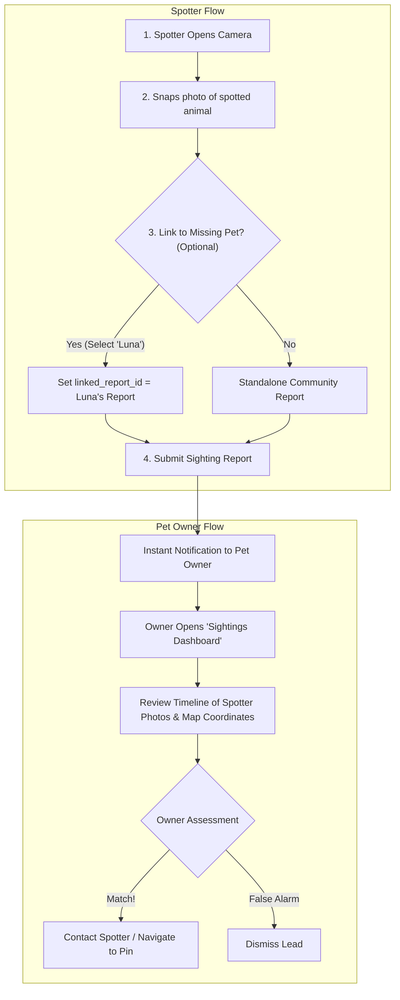

# Feature Proposal & Implementation Plan: Dedicated Sightings Tracking Dashboard

**Document Version:** 1.0  
**Target Project:** Paws and Found Mobile App & Supabase Backend  
**Status:** Proposal for Team Review  

---

## 1. Executive Summary

This proposal outlines the architectural plan to transition **Animal Sighting Reports** from standard social media comment threads into a **dedicated "Sightings Tracking Dashboard"** for pet owners.

### The Core Objective
Connect community "spotted pet" submissions directly to an active "missing pet" report, giving the pet owner a consolidated, chronological investigation dashboard of potential leads—completely separated from general community chatter.

---

## 2. Problem Statement: Why Decouple Sightings from Comments?

| Current Comment-Based Approach | Dedicated Sightings Dashboard (Proposed) |
| :--- | :--- |
| **Noise Overwhelms Signal**: In a crisis, sympathetic messages (*"Hope you find him!"*, *"Shared in Talisay!"*) push actual sightings out of sight. | **Zero Noise**: Only actual camera submissions, timestamps, and GPS pins appear on the owner's dashboard. |
| **No Structured Data**: Comments are plain text. Even with embedded cards, they lack investigative filtering or map tracing. | **Spatial Investigation**: Chronological sightings can be mapped as a trajectory (*"2:00 PM @ Lahug → 4:30 PM @ IT Park"*). |
| **No Case-Resolution Actions**: Owners can only reply with more text. | **Actionable Leads**: Owners can verify (*"Looks like my dog!"*) or dismiss (*"Not my pet"*) incoming sightings. |

---

## 3. End-to-End User Experience



---

## 4. UI Design: The Dual-Tab Experience

On any missing pet's feed card or detail screen, the bottom footer opens a unified panel with **two distinct tabs**:

```text
┌────────────────────────────────────────────────────────┐
│  Missing Pet: "Luna" (Golden Retriever)                │
│  Owner: Maria Santos • Missing since: Oct 28           │
├──────────────────────────┬─────────────────────────────┤
│   🐾 Sightings Log (3)   │   💬 Community Chat (14)    │  <-- Dual Tabs
├──────────────────────────┴─────────────────────────────┤
│                                                        │
│  [🐾 Sighting #3 - 15 mins ago]                        │
│  • Spotter: Alex R.                                    │
│  • Photo: [Thumbnail] (Golden dog near Shell gas)      │
│  • Location: Salinas Dr, Lahug (0.4 km from home)      │
│  • Status: [ New Lead ]                                │
│  • Actions: [View on Map]  [Direct Message Spotter]   │
│  ────────────────────────────────────────────────────  │
│  [🐾 Sighting #2 - 3 hours ago]                        │
│  • Spotter: Sarah L.                                   │
│  • Photo: [Thumbnail] (Running past JY Square)         │
│  • Location: Gorordo Ave, Cebu City                    │
│  • Actions: [View on Map]                              │
│                                                        │
└────────────────────────────────────────────────────────┘
```

* **Tab 1 — `🐾 Sightings Log`**:
  * Clean, card-based list of all spotter submissions linked to this missing pet.
  * Side-by-side photo comparison (Owner's original pet photo vs. Spotter's camera shot).
  * One-tap navigation to see the exact pin on the Community Animal Map.
* **Tab 2 — `💬 Community Chat`**:
  * Standard comment section where neighbors can offer encouragement, share flyers, or ask questions (*"Was she wearing a red collar?"*).

---

## 5. Database & Backend Architecture

### A. Schema Change (Single Column Addition)
Add a nullable `linked_report_id` column to the existing `public.reports` table:

```sql
-- Migration: Add linked_report_id to public.reports
alter table public.reports
add column if not exists linked_report_id uuid references public.reports(id) on delete set null;

-- Index for instantaneous lookups when opening the Sightings Dashboard
create index if not exists idx_reports_linked_report_id 
on public.reports(linked_report_id) 
where linked_report_id is not null;
```

### B. Why This Design is Extremely Clean
1. **Zero Table Duplication**: We reuse the existing, battle-tested `reports` table (with PostGIS location, storage bucket photos, and timestamps).
2. **Backward-Compatible**: Existing reports have `linked_report_id = null` and continue operating as normal standalone reports.
3. **No String Parsing**: Completely eliminates fragile URL regex parsing from comment text.
4. **Effortless Querying**: Fetching all sightings for Luna's report requires just one query:
   ```dart
   final sightings = await supabase
       .from('reports')
       .select('id, reporter_id, photo_url, location_name, created_at, profiles(name, profile_photo_url)')
       .eq('linked_report_id', missingReportId)
       .order('created_at', ascending: false);
   ```

---

## 6. Implementation Roadmap

### Phase 1: Database Migration (1-2 Hours)
- Apply `linked_report_id` column to `public.reports` in Supabase.
- Update `create_report` RPC to accept optional parameter `p_linked_report_id uuid default null`.

### Phase 2: Camera Spotter Flow (2-3 Hours)
- In [`CameraReportController`](file:///d:/User%20Files/Documents/dev%20stuff/paws_and_found/mobile_app/lib/features/report/presentation/providers/camera_report_controller.dart):
  - When submitting a report, pass `linkedReportId` into `createReport(...)`.
- In [`CameraReportPage`](file:///d:/User%20Files/Documents/dev%20stuff/paws_and_found/mobile_app/lib/features/report/presentation/pages/camera_report_page.dart):
  - Retain the existing thread picker sheet to select an active missing pet.

### Phase 3: Owner "Sightings Dashboard" UI (3-4 Hours)
- Build `SightingsDashboardModal` (or update `FeedCommentsModal` to include the dual-tab switcher).
- Render `SightingLeadCard`:
  - Spotter photo + timestamp.
  - Reverse-geocoded street address.
  - "View on Map" button navigating directly to `/map?reportId=<id>&lat=<lat>&lng=<lng>`.
  - Optional lead status toggles (`"Investigating"`, `"Confirmed"`, `"Dismissed"`).

### Phase 4: Push Notifications & Polish (Optional Next Step)
- When `linked_report_id` is set on insert, automatically dispatch a push notification to the missing pet's reporter:
  > *"Someone reported a new sighting for Luna near Salinas Dr, Lahug!"*

---

## 7. FAQ for Collaborators & Reviewers

**Q1: Does this break existing feed reports or database tables?**  
*No. `linked_report_id` is an optional foreign key (`NULL` by default). Any report created without linking remains a standard standalone post.*

**Q2: What happens if a spotter finds an animal but isn't sure which pet it is?**  
*They simply submit the report normally without picking a missing pet. The app registers it as a standalone stray/sighting on the public feed and map, and the backend AI matching engine will automatically attempt to match it against missing pets.*

**Q3: Are comments being completely deleted?**  
*No. Comments remain available in the second tab (`Community Chat`) for social coordination and messages. Sightings simply get their own dedicated, uncluttered dashboard tab.*

---

*Prepared for the Paws and Found Development Team.*
